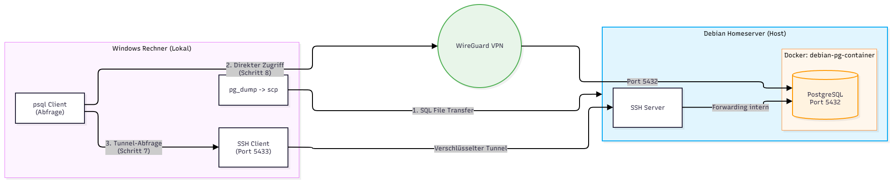

# PostgreSQL-Migration

### Systemarchitektur



## 1. Lokaler Export (Windows)
```cmd
pg_dump -U postgres -h localhost -d dvdrental -F p -f .\Desktop\SCHULE\4BHITS\INSY\Aufgabe4\dvdRentalBackup.sql
```
``````cmd
PS C:\Users\Adrian-LOQ>
PS C:\Users\Adrian-LOQ> pg_dump -U postgres -h localhost -d dvdrental -F p -f .\Desktop\SCHULE\4BHITS\INSY\Aufgabe4\dvdRentalBackup.sql
Passwort:

PS C:\Users\Adrian-LOQ>
``````

## 2. Container-Erstellung (Debian-Server)
```bash
docker run -d --name debian-pg-container -p 5432:5432 debian:latest sleep infinity
```
```bash
root@ServerDesHomes:~#
root@ServerDesHomes:~# docker run -d --name debian-pg-container -p 5432:5432 debian:latest sleep infinity
Unable to find image 'debian:latest' locally
latest: Pulling from library/debian
a1d156b0aab5: Pull complete
a431009230ae: Download complete
Digest: sha256:2dc419c6d7fe3dad0a2f9fd469c34cc90b0f9ba642d8fde837fe3d7d34a0e7f1
Status: Downloaded newer image for debian:latest
939116abbb18b283391c365422bfee4a351cf551b4b27eb612cc42e06655b9fb
root@ServerDesHomes:~#
```

## 3. PostgreSQL-Installation im Container
```bash
docker exec -it debian-pg-container apt-get update
docker exec -it debian-pg-container apt-get install -y postgresql postgresql-contrib
docker exec -it debian-pg-container service postgresql start
```
```bash
root@ServerDesHomes:~#
root@ServerDesHomes:~# docker exec -it debian-pg-container service postgresql start
Starting PostgreSQL 17 database server: main.
root@ServerDesHomes:~#
```

## 4. Dateitransfer (Windows -> Server -> Container)
```cmd
scp .\Desktop\SCHULE\4BHITS\INSY\Aufgabe4\dvdRentalBackup.sql frit@192.168.1.165:/home/frit/SCHULE/INSY/dvdRentalBackup.sql
```
```bash
docker cp /home/frit/SCHULE/INSY/dvdRentalBackup.sql debian-pg-container:/tmp/dvdRentalBackup.sql
```
``````bash
root@ServerDesHomes:~#
root@ServerDesHomes:~# docker cp /home/frit/SCHULE/INSY/dvdRentalBackup.sql debian-pg-container:/tmp/dvdRentalBackup.sql
Successfully copied 2.76MB (transferred 2.77MB) to debian-pg-container:/tmp/dvdRentalBackup.sql
root@ServerDesHomes:~#
``````

## 5. Datenbank-Konfiguration und Superuser (gemini war das :arrow_right: funktioniert)
```bash
docker exec -it debian-pg-container bash -c "sed -i \"s/#listen_addresses = 'localhost'/listen_addresses = '*'/g\" /etc/postgresql/*/main/postgresql.conf"
docker exec -it debian-pg-container bash -c "echo 'host all all 0.0.0.0/0 md5' >> /etc/postgresql/*/main/pg_hba.conf"
docker exec -it debian-pg-container service postgresql restart
docker exec -it debian-pg-container su - postgres -c "psql -c \"CREATE ROLE pgfrit WITH SUPERUSER LOGIN PASSWORD 'pgFrit';\""
docker exec -it debian-pg-container su - postgres -c "createdb -O pgfrit dvdrental"
```
## 6. Daten-Import in den Container
```bash
docker exec -it debian-pg-container bash -c "PGPASSWORD='pgFrit' psql -h 127.0.0.1 -U pgfrit -d dvdrental -f /tmp/dvdrental_sicherung.sql"
```
## 7. Zugriff mit Portforwarding (Windows)
``````cmd
ssh -L 5433:localhost:5432 frit@192.168.1.165
``````

``````cmd
PS C:\Users\Adrian-LOQ>
PS C:\Users\Adrian-LOQ> ssh -L 5433:127.0.0.1:5432 frit@192.168.1.165
frit@192.168.1.165's password:
Linux ServerDesHomes 6.12.111+deb13-amd64 #1 SMP PREEMPT_DYNAMIC Debian 6.12.111-1 (2026-09-28) x86_64

The programs included with the Debian GNU/Linux system are free software;
the exact distribution terms for each program are described in the
individual files in /usr/share/doc/*/copyright.

Debian GNU/Linux comes with ABSOLUTELY NO WARRANTY, to the extent
permitted by applicable law.
Last login: Wed Nov  4 15:59:57 2026 from 172.18.0.2
frit@ServerDesHomes:~$
``````

---

``````cmd
psql -h localhost -p 5433 -U pgfrit -d dvdrental
``````

``````sql
SELECT actor_id, first_name, last_name FROM actor LIMIT 3;
``````

``````cmd
PS C:\Users\Adrian-LOQ>
PS C:\Users\Adrian-LOQ> psql -h 127.0.0.1 -p 5433 -U pgfrit -d dvdrental
Passwort für Benutzer pgfrit:

psql (18.6, Server 17.11 (Debian 17.11-0+deb13u1))
Warnung: Konsolencodeseite (850) unterscheidet sich von der Windows-
         Codeseite (1252). 8-Bit-Zeichen funktionieren möglicherweise nicht
         richtig. Einzelheiten finden Sie auf der psql-Handbuchseite unter
         »Notes for Windows users«.
SSL-Verbindung (Protokoll: TLSv1.3, Verschlüsselungsmethode: TLS_AES_256_GCM_SHA384, Komprimierung: aus, ALPN: postgresql)
Geben Sie »help« für Hilfe ein.

dvdrental=# SELECT actor_id, first_name, last_name FROM actor LIMIT 3;
 actor_id | first_name | last_name
----------+------------+-----------
        1 | Penelope   | Guiness
        2 | Nick       | Wahlberg
        3 | Ed         | Chase
(3 Zeilen)


dvdrental=#
PS C:\Users\Adrian-LOQ>
``````

## 8. Direkter Zugriff ohne Portforwarding (Windows)

```cmd
psql -h 192.168.1.165 -p 5432 -U pgfrit -d dvdrental
```

``````sql
SELECT actor_id, first_name, last_name FROM actor LIMIT 3;
``````

``````postgresql
dvdrental=#
dvdrental=# SELECT actor_id, first_name, last_name FROM actor LIMIT 3;
 actor_id | first_name | last_name
----------+------------+-----------
        1 | Penelope   | Guiness
        2 | Nick       | Wahlberg
        3 | Ed         | Chase
(3 Zeilen)


dvdrental=#
``````

