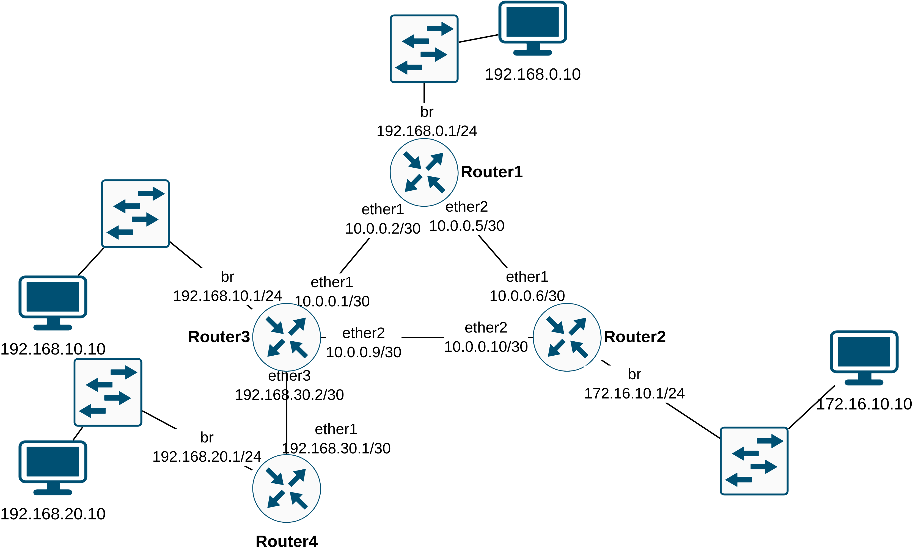

# Protokoll: Statisches Routing (MikroTik)



## 1. Adressierung (Transfernetze & LANs)

| Verbindung / LAN | Subnetz | Router A (IP) | Router B (IP) |
| :--- | :--- | :--- | :--- |
| **R1 - R3** | `10.0.0.0/30` | R1: `10.0.0.2` | R3: `10.0.0.1` |
| **R1 - R2** | `10.0.0.4/30` | R1: `10.0.0.5` | R2: `10.0.0.6` |
| **R3 - R2** | `10.0.0.8/30` | R3: `10.0.0.9` | R2: `10.0.0.10` |
| **R3 - R4** | `192.168.30.0/30` | R3: `192.168.30.2` | R4: `192.168.30.1` |
| **LAN R1** | `192.168.0.0/24` | R1: `192.168.0.1` | Client: `.10` |
| **LAN R2** | `172.16.10.0/24` | R2: `172.16.10.1` | Client: `.10` |
| **LAN R3** | `192.168.10.0/24` | R3: `192.168.10.1` | Client: `.10` |
| **LAN R4** | `192.168.20.0/24` | R4: `192.168.20.1` | Client: `.10` |

## 2. Konfiguration Router1

``````bash
[admin@Router1] > export
# 2026-09-15 12:41:34 by RouterOS 7.24.4
# software id = ZWLR-P3KW
#
# model = C52iG-5HaxD2HaxD
# serial number = HJD0A3Y9C7V
/interface bridge
add name=br
/interface ethernet switch
set switch1 cpu-flow-control=yes
/interface bridge port
add bridge=br interface=ether3
add bridge=br interface=ether4
add bridge=br interface=ether5
/ip neighbor discovery-settings
set discover-interface-list=!dynamic
/interface ovpn-server server
add mac-address=FE:79:1F:AB:4B:48 name=ovpn-server1
/ip address
add address=10.0.0.2/30 interface=ether1 network=10.0.0.0
add address=10.0.0.5/30 interface=ether2 network=10.0.0.4
add address=192.168.0.1/24 interface=br network=192.168.0.0
/ip route
add dst-address=172.16.10.0/24 gateway=10.0.0.6
add dst-address=192.168.10.0/24 gateway=10.0.0.1
add dst-address=192.168.20.0/24 gateway=10.0.0.1
add dst-address=10.0.0.8/30 gateway=10.0.0.6
add dst-address=192.168.30.0/30 gateway=10.0.0.1
/system identity
set name=Router1
[admin@Router1] > 
``````

**Statische Routen:**

| Zielnetz | Gateway |
| :--- | :--- |
| `192.168.10.0/24` | `10.0.0.1` |
| `192.168.20.0/24` | `10.0.0.1` |
| `192.168.30.0/30` | `10.0.0.1` |
| `172.16.10.0/24` | `10.0.0.6` |
| `10.0.0.8/30` | `10.0.0.6` |

## 3. Funktionstests

``````cmd
PS C:\Users\Adrian-LOQ> ping 192.168.20.10

Ping wird ausgeführt für 192.168.20.10 mit 32 Bytes Daten:
Antwort von 192.168.20.10: Bytes=32 Zeit<1ms TTL=61
Antwort von 192.168.20.10: Bytes=32 Zeit<1ms TTL=61
Antwort von 192.168.20.10: Bytes=32 Zeit<1ms TTL=61
Antwort von 192.168.20.10: Bytes=32 Zeit=1ms TTL=61

Ping-Statistik für 192.168.20.10:
    Pakete: Gesendet = 4, Empfangen = 4, Verloren = 0
    (0% Verlust),
Ca. Zeitangaben in Millisek.:
    Minimum = 0ms, Maximum = 1ms, Mittelwert = 0ms
PS C:\Users\Adrian-LOQ> tracert 192.168.20.10

Routenverfolgung zu 192.168.20.10 über maximal 30 Hops

  1    <1 ms    <1 ms    <1 ms  192.168.0.1
  2    <1 ms    <1 ms    <1 ms  10.0.0.1
  3    <1 ms    <1 ms    <1 ms  192.168.30.1
  4     2 ms    <1 ms    <1 ms  192.168.20.10

Ablaufverfolgung beendet.
PS C:\Users\Adrian-LOQ>
``````

``````cmd
PS C:\Users\Adrian-LOQ> ping 192.168.10.10

Ping wird ausgeführt für 192.168.10.10 mit 32 Bytes Daten:
Antwort von 192.168.10.10: Bytes=32 Zeit=1ms TTL=126
Antwort von 192.168.10.10: Bytes=32 Zeit<1ms TTL=126
Antwort von 192.168.10.10: Bytes=32 Zeit=1ms TTL=126
Antwort von 192.168.10.10: Bytes=32 Zeit<1ms TTL=126

Ping-Statistik für 192.168.10.10:
    Pakete: Gesendet = 4, Empfangen = 4, Verloren = 0
    (0% Verlust),
Ca. Zeitangaben in Millisek.:
    Minimum = 0ms, Maximum = 1ms, Mittelwert = 0ms
PS C:\Users\Adrian-LOQ>
``````

``````cmd
PS C:\Users\Adrian-LOQ> ping 172.16.10.10

Ping wird ausgeführt für 172.16.10.10 mit 32 Bytes Daten:
Antwort von 172.16.10.10: Bytes=32 Zeit<1ms TTL=62
Antwort von 172.16.10.10: Bytes=32 Zeit=1ms TTL=62
Antwort von 172.16.10.10: Bytes=32 Zeit=1ms TTL=62
Antwort von 172.16.10.10: Bytes=32 Zeit<1ms TTL=62

Ping-Statistik für 172.16.10.10:
    Pakete: Gesendet = 4, Empfangen = 4, Verloren = 0
    (0% Verlust),
Ca. Zeitangaben in Millisek.:
    Minimum = 0ms, Maximum = 1ms, Mittelwert = 0ms
PS C:\Users\Adrian-LOQ>
``````

