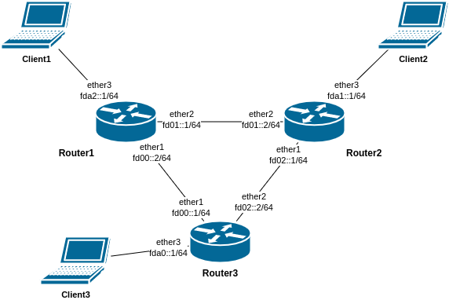

# ipv6_static_routing



## STATIC

``````bash
[admin@Router1] > 
[admin@Router1] > export
# 2026-09-15 11:35:14 by RouterOS 7.24.4
# software id = ZWLR-P3KW
#
# model = C52iG-5HaxD2HaxD
# serial number = HJD0A3Y9C7V
/ipv6 route
add dst-address=fda1::/64 gateway=fd01::2
add dst-address=fda0::/64 gateway=fd00::1
add dst-address=fd02::/64 gateway=fd01::2
/ipv6 address
add address=fd00::2 interface=ether1
add address=fd01::1 interface=ether2
add address=fda2::1 interface=ether3
/system identity
set name=Router1
[admin@Router1] > 
``````

## OSPF

``````bash
[admin@Router1] > 
[admin@Router1] > export
# 2026-09-15 11:38:22 by RouterOS 7.24.4
# software id = ZWLR-P3KW
#
# model = C52iG-5HaxD2HaxD
# serial number = HJD0A3Y9C7V
/routing ospf instance
add name=fritzospf router-id=1.1.1.1 version=3
/routing ospf area
add instance=fritzospf name=fritzospf-area
/ipv6 address
add address=fd00::2 interface=ether1
add address=fd01::1 interface=ether2
add address=fda2::1 interface=ether3
/routing ospf interface-template
add area=fritzospf-area interfaces=ether1 type=ptp
add area=fritzospf-area interfaces=ether2 type=ptp
/system identity
set name=Router1
[admin@Router1] > 
``````

