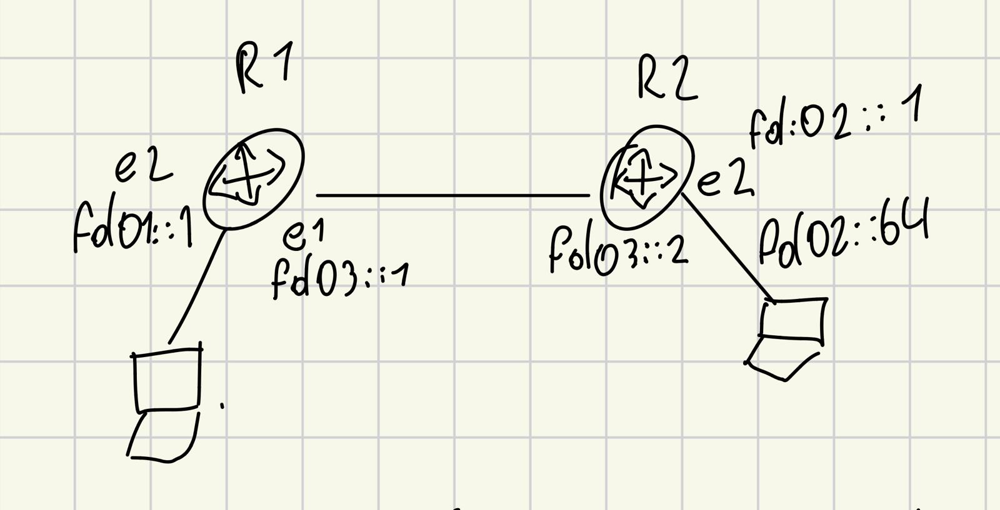
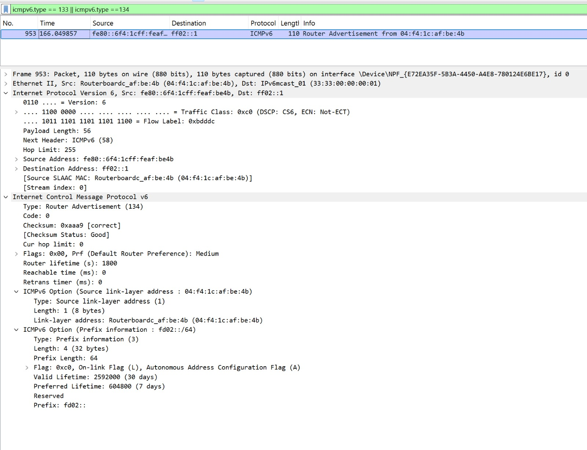
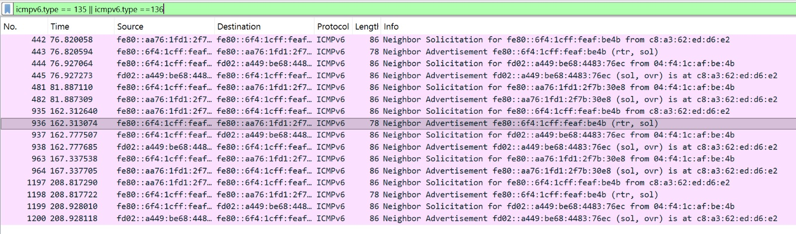
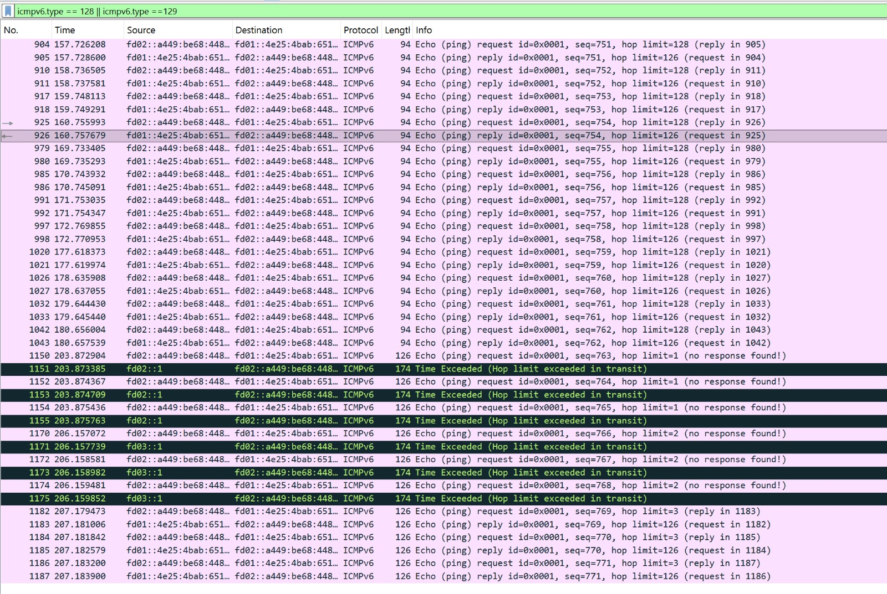

# Wireshark IPv6-Analyse: SLAAC, Link-Local, ULA (fd01/fd02) und ICMPv6

Dieses Dokument dient als Schritt-für-Schritt-Anleitung und Protokoll zur Analyse der IPv6-Mechanismen basierend auf der Netzwerktopologie und dem bereitgestellten PCAPNG-Capture.

---

## 1. Netzwerktopologie & Ausgangslage

Die Topologie besteht aus zwei Routern und den jeweiligen Client-Netzwerken sowie einer Punkt-zu-Punkt-Verbindung (Transfernetz):

```text
[ Client 1 ] 
     |
     | (e2: fd01::1/64)
  [ R1 ]
     | (e1: fd03::1/64)
     |
     | Transfernetz: fd03::/64
     |
     | (e1: fd03::2/64)
  [ R2 ] (MikroTik RouterOS - C52iG-5HaxD2HaxD)
     | (e2: fd02::1/64)
     |
[ Client 2 ] (Host: "oliverst", Autokonfiguration via SLAAC)
```



---

## 2. Die 4 Analyse-Bereiche & Filter

### Bereich 1: SLAAC (Stateless Address Autoconfiguration)

#### Erklärung
Bei SLAAC konfiguriert sich der Host ohne DHCPv6-Server selbst:
1. **Router Solicitation (RS - ICMPv6 Typ 133):** Der Client fragt per Multicast an alle Router (`ff02::2`), wer im Netz aktiv ist.
2. **Router Advertisement (RA - ICMPv6 Typ 134):** Router 2 antwortet an alle Knoten (`ff02::1`) und übermittelt das Präfix `fd02::/64`, Valid/Preferred Lifetimes sowie Autokonfigurations-Flags (A-Flag).

#### Wireshark Display Filter
```wireshark
icmpv6.type == 133 || icmpv6.type == 134
```

```text
+----------------------------------------------------------------------------------------------------+
| Wireshark Display Filter: icmpv6.type == 133 || icmpv6.type == 134                                |
+----+---------+------------------------+-------------------+----------+-----------------------------+
| No.| Time    | Source                 | Destination       | Protocol | Info                        |
+----+---------+------------------------+-------------------+----------+-----------------------------+
| 12 | 1.4231  | fe80::...              | ff02::2           | ICMPv6   | Router Solicitation         |
| 14 | 1.4245  | fe80::... (Router 2)   | ff02::1           | ICMPv6   | Router Advertisement        |
|    |         | Prefix: fd02::/64, On-link, Autonomous                                              |
+----+---------+------------------------+-------------------+----------+-----------------------------+
```


---

### Bereich 2: Link-Local (`fe80::`) & Neighbor Discovery (NDP)

#### Erklärung
* **Link-Local Adressen (`fe80::/10`):** Werden automatisch generiert und sind nur im selben L2-Segment gültig (nicht geroutet).
* **Neighbor Discovery Protocol (NDP):** Ersetzt IPv4-ARP.
  * **Neighbor Solicitation (NS - ICMPv6 Typ 135):** Adressauflösung oder Duplicate Address Detection (DAD).
  * **Neighbor Advertisement (NA - ICMPv6 Typ 136):** Antwort mit Layer-2 MAC-Adresse.

#### Wireshark Display Filter
* Nur Link-Local Adressverkehr:
  ```wireshark
  ipv6.addr == fe80::/10
  ```
* Nur Neighbor Discovery (NS / NA):
  ```wireshark
  icmpv6.type == 135 || icmpv6.type == 136
  ```

```text
+----------------------------------------------------------------------------------------------------+
| Wireshark Display Filter: icmpv6.type == 135 || icmpv6.type == 136                                |
+----+---------+------------------------+-------------------+----------+-----------------------------+
| No.| Time    | Source                 | Destination       | Protocol | Info                        |
+----+---------+------------------------+-------------------+----------+-----------------------------+
| 35 | 4.1023  | fe80::a1b2...          | ff02::1:ff...     | ICMPv6   | Neighbor Solicitation (DAD) |
| 38 | 4.1050  | fe80::c3d4...          | fe80::a1b2...     | ICMPv6   | Neighbor Advertisement      |
+----+---------+------------------------+-------------------+----------+-----------------------------+
```


---

### Bereich 3: Subnetze `fd01::` und `fd02::` (Unique Local Addresses)

#### Erklärung
* `fc00::/7` (bzw. `fd00::/8`) sind private, geroutete IPv6-Adressen (analog zu RFC 1918 bei IPv4 wie 192.168.x.x).
* Pakete zwischen Client 2 (`fd02::`) und Client 1 (`fd01::`) behalten beim Routing über R2 und R1 ihre End-to-End-Adressen bei.

#### Wireshark Display Filter
* Gezielt nach den beiden Subnetzen filtern:
  ```wireshark
  ipv6.addr == fd01::/16 or ipv6.addr == fd02::/16
  ```
* Allgemein alle ULA-Adressen filtern:
  ```wireshark
  ipv6.addr == fc00::/7
  ```

```text
+----------------------------------------------------------------------------------------------------+
| Wireshark Display Filter: ipv6.addr == fd01::/16 or ipv6.addr == fd02::/16                         |
+----+---------+------------------------+-------------------+----------+-----------------------------+
| No.| Time    | Source                 | Destination       | Protocol | Info                        |
+----+---------+------------------------+-------------------+----------+-----------------------------+
| 88 | 12.012  | fd02::... (Client)     | fd01::1 (R1)      | IPv6     | Payload / ICMPv6            |
+----+---------+------------------------+-------------------+----------+-----------------------------+
```
*(Screenshot-Platzhalter: Zeigt Pakete mit Quell-/Ziel-Adressen aus den beiden Subnetzen)*

---

### Bereich 4: ICMPv6 Pings (Echo Request & Echo Reply)

#### Erklärung
* Der klassische Ping-Befehl nutzt unter IPv6 das ICMPv6-Protokoll:
  * **Echo (ping) Request (Typ 128):** Ping-Anfrage
  * **Echo (ping) Reply (Typ 129):** Ping-Antwort

#### Wireshark Display Filter
* Alle Pings:
  ```wireshark
  icmpv6.type == 128 || icmpv6.type == 129
  ```
* **Kombinationsfilter (Ping auf Subnetz fd01:: oder fd02::):**
  ```wireshark
  (icmpv6.type == 128 || icmpv6.type == 129) && (ipv6.addr == fd01::/16 || ipv6.addr == fd02::/16)
  ```

```text
+----------------------------------------------------------------------------------------------------+
| Wireshark Display Filter: icmpv6.type == 128 || icmpv6.type == 129                                |
+----+---------+------------------------+-------------------+----------+-----------------------------+
| No.| Time    | Source                 | Destination       | Protocol | Info                        |
+----+---------+------------------------+-------------------+----------+-----------------------------+
| 102| 15.340  | fd02::...              | fd01::1           | ICMPv6   | Echo (ping) request id=0x1  |
| 103| 15.343  | fd01::1                | fd02::...         | ICMPv6   | Echo (ping) reply   id=0x1  |
+----+---------+------------------------+-------------------+----------+-----------------------------+
```


---

## 3. Kompakte Filter-Referenztabelle

| Ziel / Funktion | ICMPv6 Typ | Wireshark Display Filter |
| :--- | :--- | :--- |
| **SLAAC (RS & RA)** | 133, 134 | `icmpv6.type == 133 \|\| icmpv6.type == 134` |
| **NDP (ARP-Ersatz: NS & NA)** | 135, 136 | `icmpv6.type == 135 \|\| icmpv6.type == 136` |
| **Link-Local Verkehr** | - | `ipv6.addr == fe80::/10` |
| **ULA Subnetze (fd01/fd02)** | - | `ipv6.addr == fd01::/16 or ipv6.addr == fd02::/16` |
| **ICMPv6 Ping komplett** | 128, 129 | `icmpv6.type == 128 \|\| icmpv6.type == 129` |
| **Kombi: Ping im Testnetz** | 128, 129 | `(icmpv6.type == 128 \|\| icmpv6.type == 129) && (ipv6.addr == fd01::/16 \|\| ipv6.addr == fd02::/16)` |