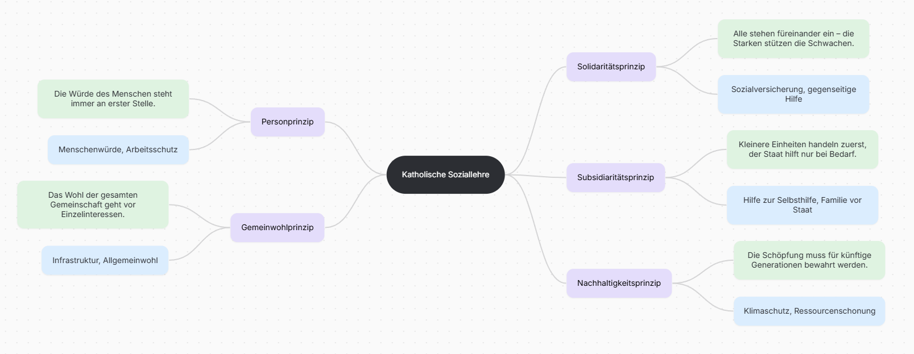

# Individualismus / Solidarität

**Individualismus:** Das Ich zählt – persönliche Freiheit und Selbstbestimmung.

**Solidarität:** Das Wir zählt – Zusammenhalt und gegenseitige Hilfe.

**Pluralismus:** Die Vielfalt zählt – das gleichberechtigte Nebeneinander verschiedener Meinungen, Lebensweisen und Interessen in einer Gesellschaft.

**mein Lebe:** 

- **allein:** Isolation, (kann) Unabhängigkeit und Freiheit bedeuten
- **abhängig von anderen:** schränkt eigene Freiheit, bietet Schutz, fremden Willen/Hilfe

**Individualethik:** Moral des Einzelnen – *„Wie handele ich persönlich gut und richtig?“*

**Sozialethik:** Moral der Gesellschaft – *„Wie gestalten wir gerechte Systeme und Gesetze?“*

- **Liberalismus:** Vorrang für persönliche Freiheit und fairen Wettbewerb; minimaler Staat.
- **Sozialismus:** Vorrang für soziale Gleichheit und Umverteilung zugunsten des Gemeinwohls.
- **Christliche Sozialethik:** Vorrang für Menschenwürde, Nächstenliebe (Solidarität) und Hilfe zur Selbsthilfe (Subsidiarität).

## Soziale Frage

**Gründe für soziale Unterschiede/Klassen:** Kapitalbesitz, Erbschaften, Bildungsherkunft, ...

**Industrielle Revolution**

​	1760-1800

​		Fabriken

**Folgen:**

* Massenproduktion
* Arbeitsteilung
* Landflucht & Urbanisierung
* Pauperismus

**Soziale Problem Felder in Österreich**

- Wohnungsnot & Wohnkosten:
- Geringe Bildungsmobilität

- Altersarmut & Gender Pension Gap 
- Inflation & Reallohnverlust

### Soziale Problem Felder in Südkorea

- Demografischer Kollaps
- Extremer Bildungsdruck
- Hyperkompetitiver Arbeitsmarkt
- Hohe Suizidrate

**Reaktionen auf die Soziale Frage: (S. 39)**

* **Karl Marx:** -> Revolution der Arbeiter -> Kommunismus

* **Adolf Kolping:** Selbsthilfegruppen

* **Freiherr von Ketteler:** -> Schutz, Gewerkschaften, Freiheit

* **Leo XIII:** "Rerum Novarum" -> Sozialreformen

  Mit seiner Enzyklika *Rerum Novarum* (1891) forderte Papst Leo XIII. gerechte Löhne, Arbeitsschutz und Gewerkschaften für ausgebeutete Arbeiter. Gleichzeitig lehnte er den Sozialismus ab und verteidigte das Privateigentum, das aber dem Gemeinwohl dienen müsse.

[doku darüber](https://www.youtube.com/watch?v=_flk1alabeA)

## Katholische Soziallehre

### [Dollar Street - photos as data to kill country stereotypes](https://www.gapminder.org/dollar-street)

* **Was ist der Zweck der Website?**

Stereotype abbauen / zeigen, dass der Lebensstandard weltweit vor allem vom Einkommen/was im monat ausgegeben wird abhängt, nicht von Kultur oder Religion. 

* **Wie ist sie aufgebaut?**

Die Welt als Straße - links leben die Ärmsten, rechts die Wohlhabendsten (dargestellt durch Kacheln sortiert nach Monatseinkommen)

* **Was kann man einstellen?**

Betten, Familien, Häuser, Haustiere, Zähne, ... (auch nach Länder/Kontinente)

* **Nenne 1 Beispiel, welches besonders eindrucksvoll ist - und warum.**

[mein Beispiel](https://www.gapminder.org/dollar-street?media=all&p=3&active=5ec4fa7cf0611d7ddd742015)